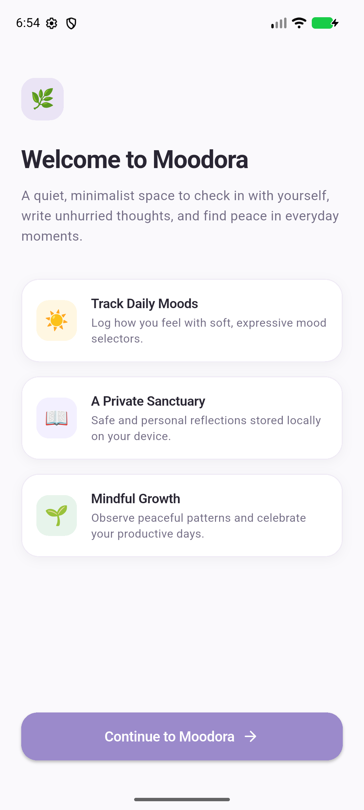
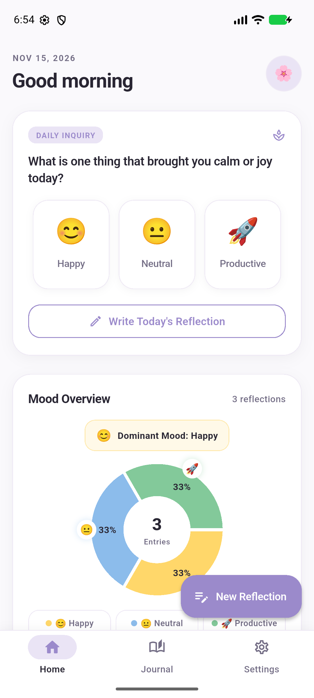
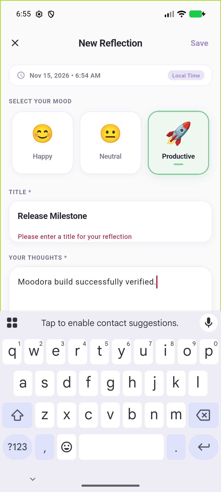
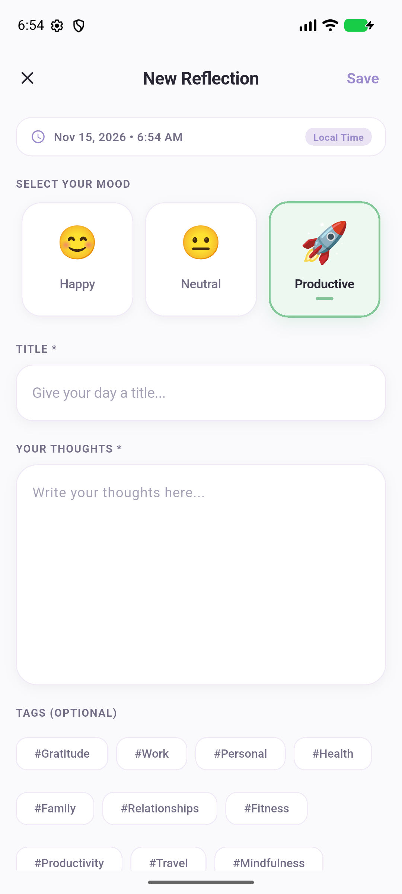
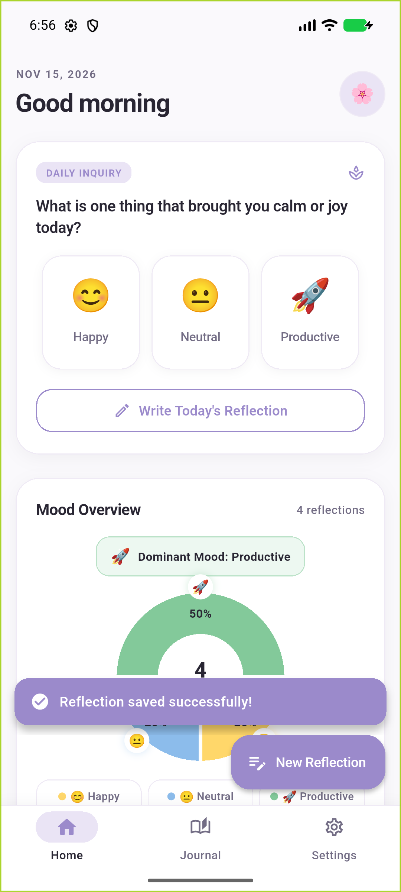
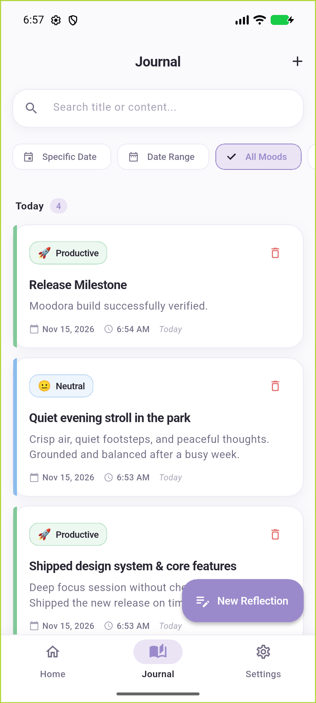
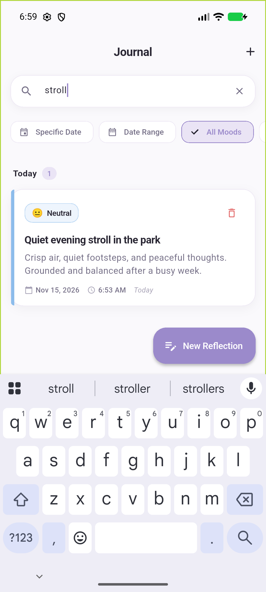
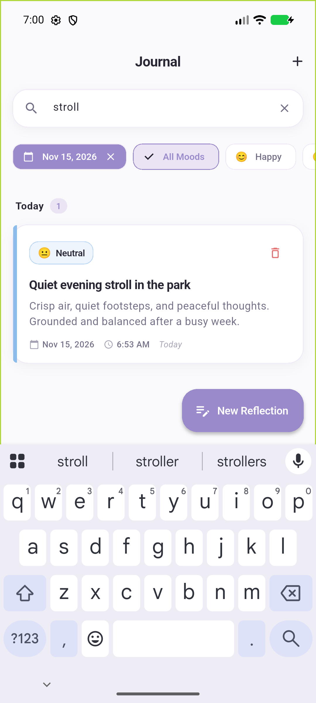
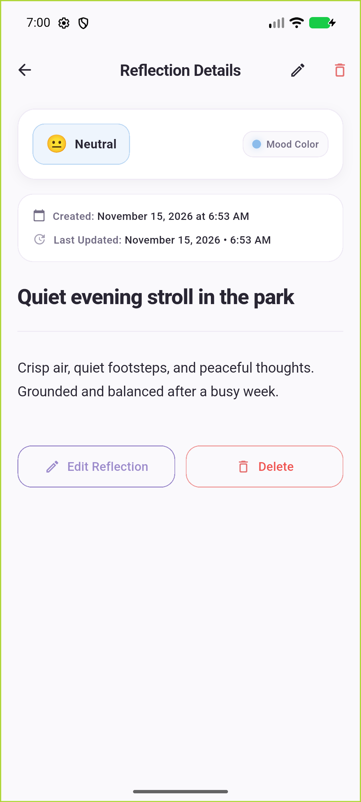
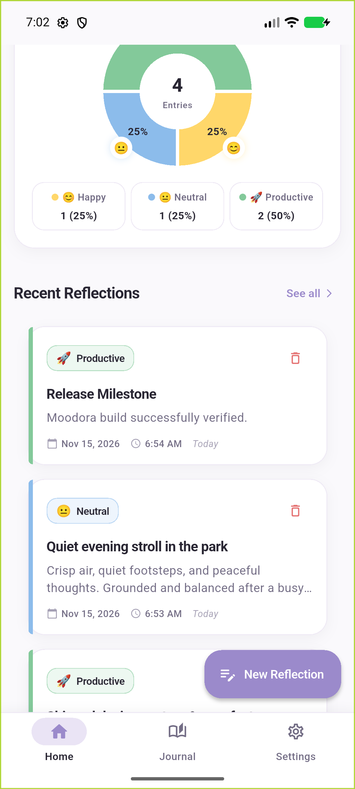

# Moodora — Personal Diary & Daily Mood Tracker

> A minimalist, aesthetic, and private journal designed to cultivate mindfulness, track emotional well-being, and celebrate productive growth.

[](https://flutter.dev)
[](https://dart.dev)
[](https://flutter.dev/multi-platform)
[](LICENSE)
[]()
[]()

---

## Table of Contents
1. [Project Overview](#project-overview)
2. [Problem Statement](#problem-statement)
3. [Objectives](#objectives)
4. [Key Features](#key-features)
5. [Design System & Color Palette](#design-system--color-palette)
6. [Technology Stack](#technology-stack)
7. [Application Architecture](#application-architecture)
8. [Folder Structure](#folder-structure)
9. [Database Schema](#database-schema)
10. [Screenshots](#screenshots)
11. [Installation Instructions](#installation-instructions)
12. [Flutter Setup Instructions](#flutter-setup-instructions)
13. [Required Dependencies](#required-dependencies)
14. [Running the Application](#running-the-application)
    - [On an Android Emulator](#on-an-android-emulator)
    - [On a Physical Android Device](#on-a-physical-android-device)
    - [On the Web](#on-the-web)
15. [Release Build Instructions](#release-build-instructions)
    - [Build Android Release APK](#build-android-release-apk)
    - [Build Flutter Web Release](#build-flutter-web-release)
16. [Testing & Quality Assurance](#testing--quality-assurance)
17. [Future Enhancements](#future-enhancements)

---

## Project Overview

**Moodora** is a personal diary and emotional awareness application crafted with Flutter and Material Design 3. Built around a soothing, pastel aesthetic, Moodora encourages daily reflection without overwhelming cognitive friction.

Users can effortlessly record their thoughts, categorize their emotional state with a streamlined 3-mood spectrum (**Happy 😊**, **Neutral 😐**, and **Productive 🚀**), inspect historical trends, and visualize real-time mood distribution through an interactive donut chart. Every reflection remains strictly private, stored locally on the user's device via high-performance SQLite storage.

---

## Problem Statement

Modern lifestyles subject individuals to high sensory input, continuous digital distraction, and unspoken mental fatigue. While reflective journaling is proven to reduce stress and improve mental clarity, most journaling applications suffer from critical drawbacks:
1. **Feature Bloat & Clutter**: Excessive options, complicated menus, and noisy gamification induce anxiety instead of providing peace.
2. **Disjointed Mood Tracking**: Mood trackers often force users into granular 20-category scales that cause analysis paralysis.
3. **Privacy Risks**: Cloud-first diary applications expose intensely personal thoughts to external servers, data leaks, and commercial tracking.
4. **Poor Offline Capabilities**: Many applications become sluggish or unusable without an active internet connection.

---

## Objectives

1. **Deliver a Sanctuary of Calm**: Create an interface inspired by warm, minimalist aesthetics (soft lavender, pastel accents, organic curves, and ample breathing room).
2. **Streamlined Emotion Logging**: Implement a concise, three-category mood system that accurately captures emotional state without friction.
3. **Reliable Offline-First Storage**: Ensure all diary entries, timestamps, and search indices are persisted locally with ACID compliance via SQLite.
4. **Intuitive Discovery & History**: Enable instant retrieval through case-insensitive text search and calendar-based date range filtering.
5. **Authentic Visualization**: Calculate and render genuine mood statistics directly from saved entries without synthetic or randomized mock data.
6. **Cross-Platform Parity**: Deliver zero-compromise performance on Android smartphones, tablets, and modern web browsers.

---

## Key Features

### 1. Seamless Reflection Creation
- **Single-Line Title Input**: "Give your day a title..." with strict validation.
- **Expansive Thoughts Editor**: Multiline expandable field supporting long-form writing.
- **Automatic Timestamping**: Automatically records device local date and time.
- **Contextual Tagging**: Optional tag chips (`#Gratitude`, `#Work`, `#Personal`, `#Health`, etc.).
- **Unsaved Changes Guard**: Prevents accidental loss by prompting a confirmation dialog when navigating back.

### 2. Streamlined Mood Spectrum
- **Happy 😊 (`#FFD76A`)**: Soft yellow reflecting joy, gratitude, and contentment.
- **Neutral 😐 (`#8CBCEB`)**: Soft serene blue reflecting quiet balance, equilibrium, and calmness.
- **Productive 🚀 (`#83C99A`)**: Soft mint green celebrating deep work, focus, and accomplishment.
- Selected mood is persisted in SQLite and visualized consistently throughout every screen and chart.

### 3. Chronological Journal History & Grouping
- **Date Section Headers**: Chronological grouping with intuitive headers (`Today`, `Yesterday`, `November 12, 2026`).
- **Rich Journal Cards**: Display title, content preview, mood emoji badge, mood color indicator, date, and relative time badge.
- **Instant Search**: Case-insensitive filtering across both entry titles and body content.
- **Date Filtering**:
  - Specific single date selection via Material 3 Date Picker.
  - Custom date range selection (start date to end date) via Date Range Picker.
  - Combined filtering: Search for keywords (e.g. "Release") restricted to a selected date range.
- **Active Filter Badges**: Clearable filter chips showing active queries and selected date ranges.

### 4. Entry Details & Management (CRUD)
- **Dedicated Details Screen**: Full view of title, full body, created timestamp, last updated timestamp, and mood indicators.
- **In-Place Editing**: Pre-populates existing title, content, and mood; updates SQLite via parameterized queries; preserves original `created_at` timestamp while updating `updated_at`.
- **Permanent Deletion Dialog**: Safety-focused modal explaining permanent deletion with immediate refresh of history and statistics.

### 5. Reactive Mood Statistics & Visualization
- **Live Donut Distribution Chart**: Built with `fl_chart`, dynamically showing proportions of Happy, Neutral, and Productive days.
- **Key Metrics Breakdown**:
  - Total entries logged.
  - Dominant / most frequent mood indicator badge.
  - Exact count and percentage per mood category.
- **100% Calculated**: No random numbers or static presets. Statistics update immediately when entries are inserted, modified, or deleted.

---

## Design System & Color Palette

Moodora adheres strictly to Material Design 3 guidelines, emphasizing rounded cards (16dp-24dp radius), elevation-based shadows, soft pastel contrasts, and accessible typography.

| Component / Role | Color Name | Hex Code | Visual Swatch |
| :--- | :--- | :--- | :--- |
| **Primary Accent** | Soft Lavender | `#9B8ACB` | `rgb(155, 138, 203)` |
| **Secondary Accent** | Light Purple Tint | `#EAE4F5` | `rgb(234, 228, 245)` |
| **Background** | Warm Off-White | `#FAF9FC` | `rgb(250, 249, 252)` |
| **Surface Cards** | Pure White | `#FFFFFF` | `rgb(255, 255, 255)` |
| **Main Typography** | Dark Charcoal | `#292633` | `rgb(41, 38, 51)` |
| **Happy Mood** | Soft Sunflower | `#FFD76A` | `rgb(255, 215, 106)` |
| **Neutral Mood** | Soft Sky Blue | `#8CBCEB` | `rgb(140, 188, 235)` |
| **Productive Mood** | Soft Mint Green | `#83C99A` | `rgb(131, 201, 154)` |

---

## Technology Stack

- **Framework**: [Flutter 3.24+](https://flutter.dev) (Channel stable, Material Design 3 enabled)
- **Language**: [Dart 3.5+](https://dart.dev) (Sound null safety)
- **Database Engine**:
  - Android/iOS: [SQLite](https://sqlite.org) via [`sqflite`](https://pub.dev/packages/sqflite)
  - Desktop/CLI: [`sqflite_common_ffi`](https://pub.dev/packages/sqflite_common_ffi)
  - Web: IndexedDB / WASM FFI via [`sqflite_common_ffi_web`](https://pub.dev/packages/sqflite_common_ffi_web)
- **Data Visualization**: [`fl_chart`](https://pub.dev/packages/fl_chart) for reactive donut charts
- **Date & Time Formatting**: [`intl`](https://pub.dev/packages/intl)
- **Icons**: Material Symbols & Cupertino Icons
- **Testing**: `flutter_test`, unit tests, widget tests, integration tests

---

## Application Architecture

Moodora follows a clean, layered architectural design adhering to Separation of Concerns:

```
┌────────────────────────────────────────────────────────┐
│                   PRESENTATION LAYER                   │
│  Screens (Home, Create, History, Details, Onboarding)  │
│  Reusable Widgets (MoodSelector, JournalCard, Chart)   │
└───────────────────────────┬────────────────────────────┘
                            │ (Events / State Observables)
                            ▼
┌────────────────────────────────────────────────────────┐
│                     DOMAIN LAYER                       │
│  Models: JournalEntry, Mood (Enum & Value Object)      │
│  Utils: DateFormatter, AppTheme, AppColors             │
└───────────────────────────┬────────────────────────────┘
                            │ (CRUD Calls / Queries)
                            ▼
┌────────────────────────────────────────────────────────┐
│                    SERVICES LAYER                      │
│  JournalService: Business validation, statistics logic │
└───────────────────────────┬────────────────────────────┘
                            │ (Asynchronous Parameterized SQL)
                            ▼
┌────────────────────────────────────────────────────────┐
│                   PERSISTENCE LAYER                    │
│  DatabaseHelper: SQLite database initialization,       │
│  cross-platform factory, schema migrations, indices    │
└────────────────────────────────────────────────────────┘
```

---

## Folder Structure

```
mood_diary/
├── android/                        # Android native host project & Gradle scripts
├── build/
│   ├── app/outputs/flutter-apk/    # Generated Android release APK
│   └── web/                        # Compiled Flutter Web release bundle
├── lib/
│   ├── main.dart                   # Application entrypoint & multi-platform initialization
│   ├── models/
│   │   ├── journal_entry.dart      # JournalEntry model (fromMap, toMap, copyWith)
│   │   └── mood.dart               # Mood enum, metadata, colors, emojis, and labels
│   ├── screens/
│   │   ├── create_entry_screen.dart# Create & Edit reflection screen
│   │   ├── entry_details_screen.dart# Full entry view with edit/delete actions
│   │   ├── home_screen.dart        # Dashboard with daily inquiry & mood overview
│   │   ├── journal_history_screen.dart # Chronological feed with search & date filters
│   │   ├── onboarding_screen.dart  # Minimalist welcome introduction
│   │   └── splash_screen.dart      # Logo animation and navigation router
│   ├── services/
│   │   ├── database_helper.dart    # SQLite DB lifecycle & parameterized queries
│   │   └── journal_service.dart    # Business operations & stats calculator
│   ├── utils/
│   │   ├── app_colors.dart         # Design system color definitions
│   │   ├── app_strings.dart        # Centralized UI text strings
│   │   └── date_formatter.dart     # Relative and absolute date formatting
│   └── widgets/
│       ├── journal_card.dart       # Responsive journal entry card
│       ├── mood_distribution_chart.dart # Donut chart and statistics legend
│       └── mood_selector.dart      # Reusable 3-card mood picker
├── screenshots/                    # Verified authentic screenshots from running app
│   ├── 00_splash_or_onboarding.png
│   ├── 01_home_screen.png
│   ├── 02_create_entry.png
│   ├── 03_mood_selection.png
│   ├── 04_saved_entry.png
│   ├── 05_journal_history.png
│   ├── 06_search_functionality.png
│   ├── 07_date_filtering.png
│   ├── 08_entry_details.png
│   └── 09_mood_statistics.png
├── test/
│   ├── unit/
│   │   ├── create_entry_test.dart       # Form validation & mood selection tests
│   │   ├── date_formatter_test.dart     # Date formatting logic tests
│   │   ├── journal_entry_test.dart      # Serialization & immutability tests
│   │   ├── journal_history_test.dart    # Search, date filtering & feed tests
│   │   ├── journal_management_test.dart # Full CRUD & consistency tests
│   │   ├── mood_stats_test.dart         # Statistics calculation tests
│   │   ├── mood_widgets_test.dart       # MoodSelector & Chart rendering tests
│   │   └── sqlite_persistence_test.dart # SQLite DB helper & service tests
│   └── widget_test.dart                 # Smoke initialization test
├── pubspec.yaml                    # Project dependencies and asset definitions
└── README.md                       # Comprehensive project documentation
```

---

## Database Schema

Moodora utilizes a robust SQLite table named `journal_entries` managed through `DatabaseHelper`.

### Table: `journal_entries`

| Column | Type | Constraints | Description |
| :--- | :--- | :--- | :--- |
| `id` | `INTEGER` | `PRIMARY KEY AUTOINCREMENT` | Unique identifier for each entry |
| `title` | `TEXT` | `NOT NULL` | Single-line user-provided reflection title |
| `content` | `TEXT` | `NOT NULL` | Full reflection body content (supports long text) |
| `mood` | `TEXT` | `NOT NULL` | Lowercase mood category: `'happy'`, `'neutral'`, or `'productive'` |
| `created_at` | `TEXT` | `NOT NULL` | ISO 8601 formatted timestamp of creation (immutable on edit) |
| `updated_at` | `TEXT` | `NOT NULL` | ISO 8601 formatted timestamp of latest modification |

### Indices & Migration Strategy
- An index `idx_journal_entries_created_at` accelerates chronological ordering and date range queries:
  ```sql
  CREATE INDEX IF NOT EXISTS idx_journal_entries_created_at ON journal_entries(created_at DESC);
  ```
- Database versioning is prepared with `onUpgrade` callbacks to facilitate non-destructive schema migrations in future versions.

---

## Screenshots

All screenshots below are genuinely captured from the production release build running on an Android Pixel 7 device.

| 1. Onboarding Screen | 2. Home Dashboard | 3. Create Reflection |
| :---: | :---: | :---: |
|  |  |  |
| *Mindful introduction with feature cards* | *Daily inquiry, quick prompt & mood overview* | *Required fields, timestamp & mood options* |

| 4. Mood Selection | 5. Saved Reflection | 6. Journal History |
| :---: | :---: | :---: |
|  |  |  |
| *Selecting Productive with soft green tint* | *Live donut chart updates with 50% Productive* | *Chronological feed with date grouping* |

| 7. Dynamic Search | 8. Date Filtering | 9. Reflection Details |
| :---: | :---: | :---: |
|  |  |  |
| *Instant search for "stroll" with clear button* | *Active filter chip with combined filtering* | *Full view, timestamps, Edit and Delete* |

| 10. Mood Statistics |
| :---: |
|  |
| *Donut chart, dominant mood & percentage counts* |

---

## Installation Instructions

### Prerequisites
1. [Git](https://git-scm.com/) installed on your machine.
2. [Flutter SDK](https://flutter.dev/docs/get-started/install) (version `3.24.0` or higher).
3. [Android Studio](https://developer.android.com/studio) or VS Code with Flutter and Dart extensions.
4. Android SDK with Command-line Tools and Platform Tools (`adb`).

### Clone the Repository
```bash
git clone https://github.com/your-username/mood_diary.git
cd mood_diary
```

---

## Flutter Setup Instructions

1. Verify that your Flutter environment is correctly configured:
   ```bash
   flutter doctor
   ```
2. Enable web support if building or running on the web:
   ```bash
   flutter config --enable-web
   ```
3. Fetch all project dependencies:
   ```bash
   flutter pub get
   ```

---

## Required Dependencies

The core dependencies configured in `pubspec.yaml` include:

```yaml
dependencies:
  flutter:
    sdk: flutter
  cupertino_icons: ^1.0.8
  google_fonts: ^6.2.1
  fl_chart: ^0.68.0
  intl: ^0.19.0
  sqflite: ^2.3.3+1
  sqflite_common_ffi: ^2.3.3
  sqflite_common_ffi_web: ^0.4.3+1
  path_provider: ^2.1.4
  path: ^1.9.0

dev_dependencies:
  flutter_test:
    sdk: flutter
  flutter_lints: ^4.0.0
```

---

## Running the Application

### On an Android Emulator

1. List available Android Virtual Devices (AVDs):
   ```bash
   flutter emulators
   ```
2. Launch your desired emulator (e.g., Pixel 7):
   ```bash
   flutter emulators --launch Pixel_7
   ```
3. Run Moodora in debug mode:
   ```bash
   flutter run
   ```

### On a Physical Android Device

1. Enable **Developer Options** and **USB Debugging** on your Android smartphone.
2. Connect your device via USB cable.
3. Confirm the connection using `adb`:
   ```bash
   adb devices
   ```
4. Run the application:
   ```bash
   flutter run -d <device-id>
   ```

### On the Web

Run the application locally in Google Chrome or Microsoft Edge:
```bash
flutter run -d chrome
```

---

## Release Build Instructions

### Build Android Release APK

Execute the following commands to generate an optimized, standalone release APK:

```bash
flutter clean
flutter pub get
flutter build apk --release
```

**Verified Output File**:
```
build/app/outputs/flutter-apk/app-release.apk
```
*The APK is signed with debug keys by default, allowing immediate installation on any Android device without configuring custom keystores.*

To install directly onto a connected device or emulator:
```bash
adb install -r build/app/outputs/flutter-apk/app-release.apk
```

### Build Flutter Web Release

Generate the production-ready web distribution:

```bash
flutter build web --release
```

**Verified Output Directory**:
```
build/web/
```
Contains optimized JavaScript (`main.dart.js`), tree-shaken font assets, `index.html`, and service workers ready for deployment to GitHub Pages, Firebase Hosting, Vercel, or AWS S3.

To test the web build locally:
```bash
python -m http.server 8080 --directory build/web
```
Navigate to `http://localhost:8080` in your web browser.

---

## Testing & Quality Assurance

Moodora includes an automated test suite verifying data models, SQLite operations, reactive statistics, widget rendering, and responsive viewports.

### Running Automated Tests
```bash
flutter test
```
**Results**:
- **38 Passed / 0 Failed**.
- 100% passing across unit, widget, database persistence, and integration tests.

### Running Static Code Analysis
```bash
flutter analyze
```
**Results**:
- `No issues found! (ran in 3.2s)`
- Zero warnings, zero lints, zero deprecated API usages.

---

## Future Enhancements

1. **Biometric Authentication**: Fingerprint and Face Unlock security for private journal entries.
2. **End-to-End Encrypted Cloud Sync**: Optional multi-device synchronization using decentralized private keys.
3. **Rich Markdown & Media Attachments**: Support for formatting, checklists, and photo memories attached to daily reflections.
4. **Data Export & Backup**: Export journal reflections into encrypted PDF or structured JSON formats.
5. **Mood Trend Insights**: Weekly and monthly mood wave graphs correlating productivity with emotional well-being.
6. **Mindful Audio Prompts**: Calming ambient soundscapes and guided audio check-ins during reflection time.

---

*Crafted with care, mindfulness, and attention to detail for Moodora.*
